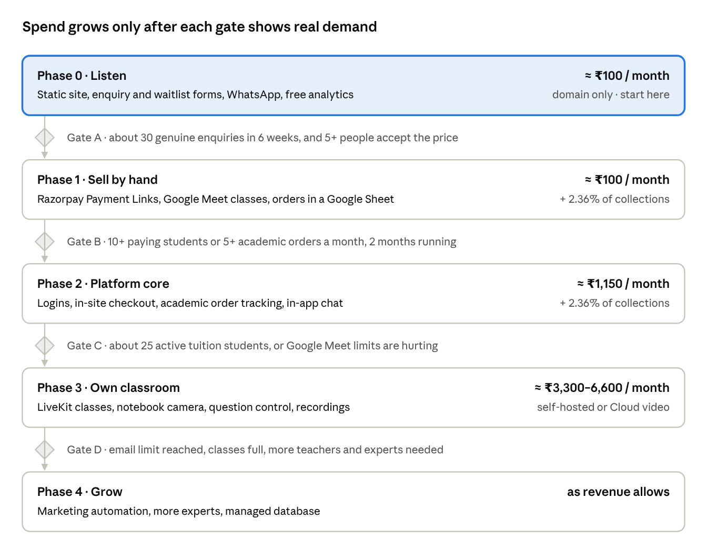
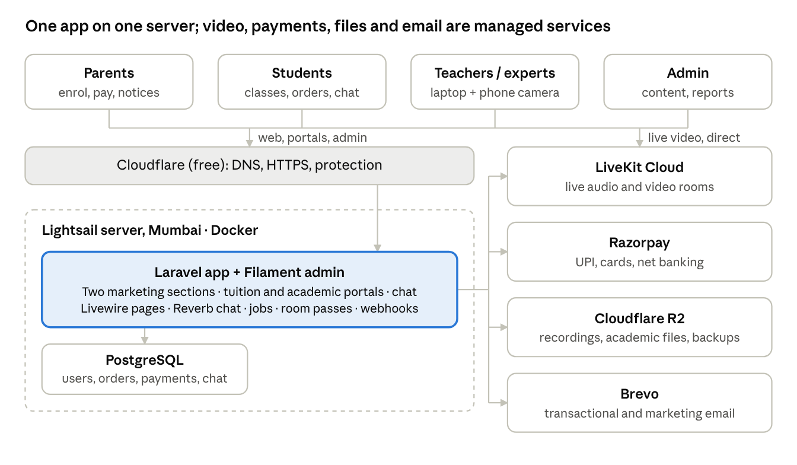

# Online Tuition & Academic Services Platform — v1 Spec, Architecture & Setup Guide

Oct 9, 2026 · @Ashim Ghose

## Overview

Version 1 is a single web app where parents pay for live online tuition
(classes 1 to 12), students attend paid classes and watch recordings,
teachers run and record classes, and an admin tracks teachers, students
and money. It is built for a budget of a few thousand rupees a month at
launch, on open-source software with no paid CMS or licences.

A second line of business, **academic assignment support**, serves
Bachelors, Masters and PhD students in any stream. They buy help with a
research paper, research book, synopsis, thesis or dissertation from a
price list you set, pay online, and follow the order's status (for
example Not picked yet, In progress, Complete, Shipped) in their own
space. Printing and courier are priced add-ons. Each offering has its
own marketing section, and one chat lets students reach the admin or a
teacher about either.

**Scope guardrail for academic services:** sell guidance, structuring,
editing, proofreading, formatting to the university's style, similarity
checking, printing and binding, not finished work for the student to
submit as their own. UGC's 2018 anti-plagiarism rules can cancel a
thesis registration when more than 60% of the text matches other sources
([CASRAI
summary](https://casrai.org/guides/ugc-india-anti-plagiarism-regulations-2018)),
and universities treat work written by someone else as misconduct.
Selling ghostwritten theses would put your customers' degrees and your
brand at risk. Get a lawyer to review the service descriptions and
terms.

**Scale assumptions for v1:** up to 1,000 site visitors a month, up to
50 paying students, a handful of teachers, small batches of up to 15
students per live class, and up to 20 academic orders a month.

**v1 goals**

1.  A parent can sign up, add a child, pay by UPI or card, and the child
    can join that subject's live class the same day.

2.  A teacher can run a live audio/video class with a second camera on a
    notebook or whiteboard, control who speaks, and optionally record
    it.

3.  A Bachelors, Masters or PhD student can sign up, choose an academic
    service with add-ons, pay, upload their brief, and see the order's
    status change until delivery.

4.  Students and parents can chat with the admin or an assigned teacher
    about either offering.

5.  The admin can see who has paid, what each teacher or expert is owed,
    academic orders by status, and money in vs money out for each
    offering.

6.  The admin can edit both marketing sections, the price list, the
    order statuses and all site content without code.

7.  The whole system runs on one laptop for testing, with fake payments,
    local email and local video.

**Not in v1 (later phases):** native mobile apps, automatic teacher
payouts, AI features, homework/assignment grading, multi-language UI,
multiple tuition centres, and courses beyond school tuition. Keep these
out so v1 ships.

**Done means:** one real batch of students has paid online and attended
at least four live classes, at least five academic orders have gone from
payment to delivery, and the admin has closed one month's teacher and
expert payouts from the reports.

## Phased rollout

Launch with an informational website that costs about ₹100 a month (just
the domain). Switch on the costly parts (in-site payments, chat, your
own video classroom) only after real demand shows up and can pay for
them. Each phase ends at a gate, a measurable sign of interest defined
in *Measuring interest and campaigns*. Do things by hand first
(WhatsApp, payment links, Google Meet), and automate only what has
proven itself.

You build the code once. Each module (payments, chat, classroom,
recordings) sits behind an on/off setting, so you can build Phase 2 and
3 on your laptop while Phase 0 or 1 runs live.

rollout roadmap · 5 phases, 4 interest gates

Run the gates separately for each offering: academic orders may justify
Phase 2 well before tuition justifies its own classroom.

- **Phase 0, Listen:** a static website on Cloudflare Pages (free plan:
  500 builds a month, static bandwidth unmetered, [temps.sh
  summary](https://temps.sh/blog/cloudflare-pages-free-tier-limits-2026)).
  It has separate *Tuition* and *Academic assignments* sections, enquiry
  and waitlist forms, a WhatsApp chat button, and free cookie-less
  Cloudflare Web Analytics.

- **Phase 1, Sell by hand:** Razorpay Payment Links for fees and orders
  (same 2% + GST, no code needed). Classes run on Google Meet, where
  free accounts allow 60 minutes for group calls of 3 or more
  ([PhoneArena](https://www.phonearena.com/news/google-meet-free-users-group-call-meeting-duration_id133561)),
  so plan 55-minute classes. Track academic orders in a Google Sheet,
  and chat on the WhatsApp Business app.

- **Phase 2, Platform core:** deploy the Laravel app with its Filament
  admin. It adds logins, in-site checkout, academic order tracking with
  statuses, in-app chat and tuition enrolment. Class links are still
  Google Meet, stored on each session.

- **Phase 3, Own classroom:** LiveKit live classes with the notebook
  camera, recordings, attendance and question control.

- **Phase 4, Grow:** marketing automation, more teachers and experts,
  server-side recording, managed database.

## Users and journeys

The parent owns the account and the child's login hangs off it. This one
choice handles payments, parental consent for minors' data, and "who to
inform" in a single place.

| Role                   | How they get an account                                   | Main journeys in v1                                                                                                                 |
|------------------------|-----------------------------------------------------------|-------------------------------------------------------------------------------------------------------------------------------------|
| Visitor                | None                                                      | Browse the Tuition and Academic sections, prices, teachers, FAQs; enquire, book a demo or join a waitlist; WhatsApp chat            |
| Parent                 | Self sign-up with email, verifies email                   | Add children, give consent, pick subjects/batches, pay by UPI or card, see receipts, get notices, read and join their child's chats |
| Student (school)       | Created by the parent (username or email + password)      | See timetable, join paid live classes, ask questions when allowed, watch recordings, chat with teacher (visible to parent)          |
| Academic student (18+) | Self sign-up with email, verifies email, confirms age 18+ | Choose a service and add-ons, upload the brief, pay, track order status, download deliveries, chat about the order                  |
| Teacher / expert       | Invited by admin (email link to set password)             | Tuition: run own batches and recordings. Academic: see assigned orders, upload drafts, update status. Answer assigned chats         |
| Admin                  | Created at setup (first user)                             | Manage teachers and experts, price lists, add-ons, order statuses, both marketing sections, chat inbox, payouts and reports         |

**Key journey: from visit to first class**

1.  Visitor reads the subject page and clicks Enrol.

2.  Parent signs up, verifies email, adds a child (name, class, board)
    and ticks the consent box.

3.  Parent chooses a batch (for example Class 9 Maths, CBSE, Mon/Wed/Fri
    6 pm) and pays the month's fee.

4.  Payment confirmation arrives by webhook; the enrolment becomes
    Active until the paid-through date; parent and student get an email.

5.  At class time the student logs in, sees Join on the class card, and
    enters the room. Unpaid or expired enrolments see Pay to join
    instead and the parent is emailed.

**Key journey: academic order from enquiry to delivery**

1.  A Masters student lands on the Academic section from a campaign link
    and opens "Dissertation formatting and editing".

2.  They sign up, confirm they are 18 or older, and start an order:
    university, course, topic, deadline, word count, guidelines file.

3.  They pick add-ons (for example 3 printed hard-bound copies and
    courier to Pune) and see the total: base price + add-ons + GST.

4.  They pay by UPI or card. The order moves to the first status, *Not
    picked yet*, and they get an email.

5.  The admin assigns an expert. The status moves through *In progress*,
    *Draft shared*, *Complete*, *Printed* and *Shipped* (with courier
    tracking number). The student sees each change and gets an email
    when a status is set to notify.

6.  For a job too complex for the price list, the student clicks
    *Request a quote*; the admin sets a custom price and the student
    pays from their order page.

## Functional requirements

Each requirement has an ID so you can tell Claude Code "implement CLS-4"
and it knows exactly what to build and test.

**Accounts and login (AUTH)**

- AUTH-1 Parent self sign-up with name, email, mobile, password; email
  verification link before first login.

- AUTH-2 Login, logout, and forgot-password (emailed reset link, valid 1
  hour, single use).

- AUTH-3 Parent creates student logins for each child; parent can reset
  a child's password.

- AUTH-4 Admin invites teachers by email; teacher sets their own
  password from the link.

- AUTH-5 Role-based access: each page and API checks the role (visitor,
  parent, student, teacher, admin) on the server, never only in the
  browser.

- AUTH-6 Lock an account for 15 minutes after 5 failed logins; admin can
  deactivate any account.

**Public site and content (CMS)**

- CMS-1 Admin edits these without code: home page sections, subjects,
  classes and boards offered, fee plans, teacher profiles, testimonials,
  FAQs, banners, images.

- CMS-2 Pages: Home (introduces both offerings), the Tuition section and
  the Academic section (see MKT-1), Teachers and experts, About,
  Resources/blog, Contact, Privacy policy, Terms, Refund policy.

- CMS-3 Enquiry and demo-booking forms store leads in the admin panel
  and add them to the email marketing list (with consent tick).

- CMS-4 Basic SEO: page titles, descriptions, sitemap, share images;
  pages load fast on a 4G phone.

**Batches, timetable and live classes (CLS)**

- CLS-1 Admin creates batches: subject, class, board, teacher, schedule,
  max seats (default 15), monthly fee.

- CLS-2 Each scheduled session appears on the teacher's and enrolled
  students' timetables; Join opens 10 minutes before start.

- CLS-3 Join is allowed only if the student has an Active enrolment
  (paid-through date covers today) and is not removed from the batch.
  Checked on the server when issuing the room token.

- CLS-4 Teacher controls in class: mute one or all, turn "questions
  allowed" on/off (when off, students cannot unmute or post in chat;
  raise-hand still queues), lower hands, spotlight a student.

- CLS-5 Teacher can add a second camera: choose another camera on the
  same laptop, or scan a QR code to join a phone as a "notebook camera"
  pointed at the book or whiteboard. Students see it large, teacher's
  face small.

- CLS-6 Screen share for slides or PDFs.

- CLS-7 Teacher can admit an extra enrolled student mid-class, remove a
  student from the current class (they cannot rejoin that session), or
  permanently remove them from the batch (enrolment ends; admin and
  parent are notified).

- CLS-8 Attendance recorded automatically: join and leave times per
  student per session.

- CLS-9 Class chat for questions when questions are allowed; saved with
  the session.

**Recordings (REC)**

- REC-1 Teacher chooses "Record this class" before or during the class;
  default comes from the batch setting.

- REC-2 A recording is saved against batch, session, teacher and date,
  with a teacher-editable title and tags (for example "Ch 4 Quadratic
  equations", "revision").

- REC-3 Students see recordings only for batches they have an Active
  enrolment in; videos stream through short-lived signed links and
  cannot be shared publicly.

- REC-4 Admin sets a retention period (default 180 days) after which
  recordings are deleted automatically.

**Payments (PAY)**

- PAY-1 Parent pays per child per batch per month, and an academic
  student pays per order (base price + add-ons + GST, or an admin
  quote), by UPI, debit card, credit card or net banking through the
  payment gateway's checkout.

- PAY-2 Enrolment becomes Active only after the server verifies the
  gateway's payment signature or webhook, never from the browser
  redirect alone.

- PAY-3 Parent sees payment history and downloads a receipt (PDF) for
  each payment.

- PAY-4 Reminder emails 5 days and 1 day before the paid-through date;
  access stops after a 3-day grace period.

- PAY-5 Admin can record an offline payment (cash or bank transfer) and
  issue a refund through the gateway.

**Admin and reports (ADM)**

- ADM-1 Register, deactivate and reactivate teachers and experts; set
  each one's payout rate per class taken (or per hour) and per academic
  order (fixed or % of order).

- ADM-2 Teacher payout report for a month: classes conducted (sessions
  that actually started and ran at least 30 minutes), rate, amount due;
  mark as paid with date and reference.

- ADM-3 Subscription report: students per batch, Active / Expired /
  Removed, paid-through dates.

- ADM-4 Money report for any date range, split by offering (Tuition,
  Academic): received vs paid to teachers and experts vs gateway fees vs
  printing and courier costs, with the net. Plus an academic orders
  report by status, service and expert.

- ADM-5 Lists of active and past teachers and active and past students,
  filterable, exportable to CSV.

- ADM-6 Audit log of admin actions (who changed what and when).

**Notifications (NOT)**

- NOT-1 Transactional emails: verify email, welcome, password reset,
  teacher invite, payment success / failure, receipt, renewal reminder,
  access paused, removed from batch, class rescheduled or cancelled,
  academic order placed, status changed (when the status is set to
  notify), quote ready, new chat message unread for 15 minutes.

- NOT-2 Admin can post a notice to all parents, or to parents of one
  batch; it shows on their dashboard and is emailed.

- NOT-3 Marketing emails (newsletters, new batch announcements) go only
  to people who opted in, with one-click unsubscribe.

**Academic assignment services (ACA)**, built in Phase 2

- ACA-1 Admin manages the service catalogue: service type (research
  paper, research book, synopsis, thesis, dissertation, and new types
  the admin adds), level (Bachelors, Masters, PhD), stream, description,
  what's included, turnaround days, free revisions, base price,
  active/inactive.

- ACA-2 Admin manages add-ons with prices: printing (per copy, by
  binding type such as spiral, soft or hard bound), courier (by zone or
  flat), express turnaround. Each service lists which add-ons apply.

- ACA-3 Academic students self sign-up with email verification and an "I
  am 18 or older" declaration; under-18s are pointed to the Tuition
  section.

- ACA-4 Order form: university, course, stream, topic, deadline, word or
  page count, notes, file uploads (PDF, DOCX, up to 25 MB each),
  add-ons, delivery address only if printing or courier is chosen. Shows
  an itemised total before payment.

- ACA-5 *Request a quote* for jobs outside the price list: the admin
  sets a custom price and expiry; the student pays from the order page.

- ACA-6 Admin-configurable order statuses: name, display order, colour,
  whether the student is emailed, whether it is a final status. Default
  list: Awaiting payment, Not picked yet, Assigned, In progress, Draft
  shared, Revision requested, Complete, Printed, Shipped, Delivered,
  Cancelled.

- ACA-7 Each status change is kept as history (who, when, note), shown
  to the student as a timeline. Shipped captures courier name and
  tracking number.

- ACA-8 Student's space lists their orders with current status,
  timeline, files delivered (download), revisions left, invoice, and a
  chat thread for the order.

- ACA-9 Admin assigns each order to an expert; the expert sees only
  assigned orders, uploads drafts and finals, and moves the status
  within allowed steps.

- ACA-10 Expert payout per completed order feeds the payout report
  (ADM-2).

**Chat (CHAT)**, WhatsApp button from Phase 0, in-app chat in Phase 2

- CHAT-1 Logged-in parents, school students and academic students start
  a conversation tagged *Tuition* or *Academic*, optionally linked to a
  batch or an order.

- CHAT-2 Admin inbox shows all conversations with unread counts and lets
  the admin assign a conversation to a teacher or expert, who then sees
  only their assigned or own-batch conversations.

- CHAT-3 Text messages with attachments (images, PDF, DOCX up to 10 MB);
  read receipts; near-real-time updates without a paid service.

- CHAT-4 Safeguarding: every chat with a school student is visible to
  that student's parent, and there are no private teacher-to-minor
  channels.

- CHAT-5 Office hours shown in the chat window with an automatic "we'll
  reply by" message outside them.

- CHAT-6 A WhatsApp click-to-chat button on public pages, with a
  different pre-filled message for each section so you can tell which
  offering the chat came from.

**Marketing and interest tracking (MKT)**, Phase 0 onwards

- MKT-1 Two separate marketing sections, /tuition and /academic, each
  with its own hero, services and prices, how it works, teachers or
  experts, testimonials, FAQs and call to action, all editable by the
  admin.

- MKT-2 Admin creates campaign landing pages (headline, offer, form,
  expiry) for each offering, for example "Free synopsis review for PhD
  scholars this month".

- MKT-3 Every enquiry, demo request and waitlist sign-up records the
  offering, the page, and the campaign source from the link (UTM tags or
  QR code).

- MKT-4 "Notify me" waitlists for services not live yet (for example
  "Live classes starting soon", "Thesis printing in Kolkata").

- MKT-5 Interest dashboard for the admin: leads per week by offering,
  service and source, and how many became paying customers.

- MKT-6 Resources/blog section for search traffic (guides such as "How
  to structure a synopsis").

- MKT-7 Referral codes that give the referrer and the new customer a
  discount, tracked per code.

## Non-functional requirements

Almost all your users are minors, so privacy is a design requirement,
not an add-on. India's DPDP Act treats everyone under 18 as a child: you
need verifiable parental consent before processing a child's data, and
you may not track, profile or target ads at children. The DPDP Rules
were notified in November 2025 and phase in over 18 months, with the
main consent and children's-data duties in force by May 2027
([IAPP](https://iapp.org/news/a/notes-from-the-asia-pacific-region-india-releases-dpdpa-rules-ai-governance-guidelines),
[Seclore
guide](https://www.seclore.com/fundamentals/dpdp-rules-2025-compliance-guide/)).
Building it in now costs little; retrofitting later is expensive. Have a
lawyer review the privacy policy and consent text before launch.

**Privacy (minors' data)**

- Only a verified parent account can create a child profile; the parent
  ticks a consent statement that is stored with date, time and policy
  version. Withdrawing consent is one click and deactivates the child's
  login.

- Collect the minimum about a child: first name, class, board, school
  (optional). No child phone numbers, photos or addresses.

- No third-party ad trackers or behavioural analytics on logged-in
  pages. Use privacy-friendly, cookie-less analytics on public pages
  only.

- Recordings show students' video only if they turned their camera on;
  tell parents this in the consent text.

- Parent can download or delete their family's data (deletion keeps
  financial records the law requires).

**Privacy (adult academic students)**

- Academic students are adults and consent for themselves; store the 18+
  declaration and consent with date and policy version.

- Their uploaded briefs, drafts and theses are confidential: private
  storage, signed download links, visible only to the student, the
  assigned expert and the admin. Delete files a set time after delivery
  (default 90 days) unless the student asks to keep them.

- Delivery addresses are collected only for orders with printing or
  courier.

- Campaign tracking (UTM tags, analytics) runs on public pages only.
  Tuition ads and posts target parents, never children.

**Security**

- HTTPS everywhere; passwords hashed by the framework; session cookies
  HTTP-only and secure.

- All permission checks on the server; room tokens and video links
  expire within minutes to hours.

- Rate limits on login, sign-up, forgot-password and enquiry forms;
  CAPTCHA on public forms.

- Payment card and UPI details never touch your server; the gateway's
  checkout handles them.

- Secrets only in environment variables; never committed to Git.

- Nightly encrypted database backup to object storage, kept 30 days; a
  restore is tested once before launch.

<!-- -->

- Uploaded files: allow only PDF, DOCX, images and ZIP within size
  limits; check the file type on the server, never trust the name.

- Chat: rate-limit messages, keep a full history the admin can review,
  and let users report a message.

**Performance and capacity**

- Public pages under 2.5 seconds on a mid-range Android phone over 4G.

- Live classes: up to 15 students plus teacher and notebook camera per
  room; 3 classes running at the same time.

- Video adapts to weak connections; students on poor networks can switch
  to audio plus notebook camera only.

**Availability and operations**

- Target 99.5% uptime during class hours (6 am to 10 pm IST). Deploys
  happen outside class hours.

- Uptime monitor and error alerts to your email or phone.

- Every change goes through Git, automated tests, then deploy; one
  command to roll back.

## Architecture and technology stack

One Laravel application with a Filament admin panel, one PostgreSQL
database, and managed services for the hard parts: LiveKit for video,
Razorpay for payments, Cloudflare R2 for files, Brevo for email. Laravel
renders every page on the server, so marketing pages are fully readable
by search engines without a separate front-end framework. Every outside
service is reached through Laravel's own drivers or one module of yours,
so moving to a bigger or managed service later is a configuration
change, not a rewrite. Everything runs on one laptop for testing.

system architecture · 1 server, 4 managed services

Pages and portals load through Cloudflare from the one server; live
video flows directly between browsers and LiveKit, using a short-lived
token the app issues only to students with an active enrolment.

That picture is the end state (Phase 3). Phase 0 uses the same Laravel
code: the marketing pages are Blade templates, exported to plain HTML
with the free
[spatie/laravel-export](https://root.packagist.org/packages/spatie/laravel-export)
package and hosted on Cloudflare Pages, with forms in Google Forms, chat
on WhatsApp and analytics from Cloudflare, all on free plans. Phase 2
deploys the same app to the Lightsail server with Filament, Postgres and
in-app chat; Phase 3 adds LiveKit.

| Layer                            | Use now                                                                                                                                                                                                                            | Change later by                                                                   | From phase |
|----------------------------------|------------------------------------------------------------------------------------------------------------------------------------------------------------------------------------------------------------------------------------|-----------------------------------------------------------------------------------|------------|
| Language and framework           | PHP 8.4+ and Laravel (13.x at time of writing)                                                                                                                                                                                     | Upgrading Laravel once a year, following its upgrade guide                        | 0          |
| Public pages                     | Blade templates + Tailwind CSS, rendered on the server                                                                                                                                                                             | —                                                                                 | 0          |
| Phase 0 hosting                  | Blade pages exported to static HTML ([spatie/laravel-export](https://root.packagist.org/packages/spatie/laravel-export)), on Cloudflare Pages free plan                                                                            | Deploying the full app to a server in Phase 2                                     | 0          |
| Phase 0 forms and chat           | Google Forms + Google Sheet; WhatsApp Business app                                                                                                                                                                                 | Site forms and in-app chat in Phase 2                                             | 0          |
| Analytics                        | Cloudflare Web Analytics, cookie-less                                                                                                                                                                                              | —                                                                                 | 0          |
| Interactive pages                | Livewire + Alpine.js (order form, chat, dashboards)                                                                                                                                                                                | Adding React only where needed (the classroom)                                    | 2          |
| Admin panel and content          | [Filament](https://dev.co/cms/open-source/filament), free (MIT)                                                                                                                                                                    | —                                                                                 | 2          |
| Database access                  | Eloquent models and migrations                                                                                                                                                                                                     | Switching database engine with a setting, if you keep to standard SQL             | 0          |
| Database                         | SQLite on the laptop for Phase 0; PostgreSQL from Phase 2                                                                                                                                                                          | Moving Postgres to a managed service by changing the connection setting           | 2          |
| Cache, sessions, background jobs | Laravel's database driver                                                                                                                                                                                                          | Switching to Redis with a setting                                                 | 2          |
| File storage                     | Laravel Storage: local disk in development, [Cloudflare R2](https://developers.cloudflare.com/r2/pricing/) in production (10 GB free)                                                                                              | Changing the storage setting; code stays the same                                 | 2          |
| Email                            | Laravel Mail: Mailpit locally, [Brevo](https://www.brevo.com/pricing/) free plan (300 a day)                                                                                                                                       | Changing the mail setting, for example to Amazon SES                              | 0          |
| Chat updates                     | Laravel Reverb, self-hosted, free                                                                                                                                                                                                  | A Pusher-compatible hosted service, by setting                                    | 2          |
| Payments                         | [Razorpay](https://razorpay.com/pricing/) Payment Links (Phase 1), then Razorpay's PHP library inside your own payments module (2% + GST)                                                                                          | Adding or swapping a gateway inside that one module                               | 1          |
| Live classes                     | Google Meet (Phase 1–2), then [LiveKit](https://livekit.com/pricing) inside your own video module; server passes via the community [PHP SDK](https://packagist.org/packages/agence104/livekit-server-sdk), classroom page in React | LiveKit Cloud or self-hosted, by setting                                          | 1 / 3      |
| Hosting (app)                    | [AWS Lightsail](https://aws.amazon.com/lightsail/pricing/) Mumbai: 2 GB (\$12) in Phase 2, 4 GB (\$24) in Phase 3                                                                                                                  | Bigger server, then two servers behind a load balancer, or a managed Laravel host | 2          |
| Local development                | composer run dev with SQLite (Phase 0–1); Laravel Sail, the official Docker setup, with Postgres and Mailpit (Phase 2+)                                                                                                            | —                                                                                 | 0          |
| DNS, HTTPS, protection           | Cloudflare free plan; Caddy or Nginx on the server                                                                                                                                                                                 | —                                                                                 | 0          |
| Testing                          | Pest (unit and feature tests), Playwright (browser tests)                                                                                                                                                                          | —                                                                                 | 0          |
| Monitoring                       | A free uptime monitor and a free error-tracking tier (for example Sentry)                                                                                                                                                          | —                                                                                 | 2          |

**Choices considered and set aside**

- **Next.js + Payload CMS (the earlier plan):** works, and Next.js does
  not need Vercel; it runs on any Node server, in Docker or as a static
  export ([Next.js deploying
  docs](https://nextjs.org/docs/app/getting-started/deploying)). Set
  aside because this platform is mostly admin work (price lists,
  statuses, payouts, reports), where Laravel + Filament needs less code.
  Laravel also changes more slowly than Payload and Next.js, which both
  release very often, and it is lighter to run on a laptop.

- **Plain React single-page app:** only a front end, so it still needs a
  separate back end for logins, payments and webhooks (two codebases).
  It builds pages in the visitor's browser, which is weaker for search
  engines and link previews on marketing pages.

- **Vercel hosting:** the free Hobby plan forbids commercial use, so a
  paying business needs Pro at \$20 per user per month ([Vercel terms
  summary](https://zplatform.ai/guides/is-vercel-free/)). Not needed for
  Laravel anyway.

- **100ms for video:** 10,000 free minutes, but costlier than LiveKit at
  your usage ([100ms pricing](https://www.100ms.live/pricing)).

- **WordPress or a paid CMS:** you asked for no paid CMS, and a separate
  CMS would split your data in two.

**Built to move and scale.** Four rules keep later moves easy:

1.  The app server keeps nothing of its own: sessions, cache and jobs
    live in the database (later Redis), files live in R2. A second
    server can then be added without code changes.

2.  Every outside service sits behind a Laravel driver setting or one
    module of yours: database, storage, mail, payments, video, chat.

3.  Every database change is a migration, so moving the database is a
    backup and restore.

4.  Use standard SQL so Postgres moves easily to a managed service.

| Signal                                                    | Step                                                                                               | Effort                                              |
|-----------------------------------------------------------|----------------------------------------------------------------------------------------------------|-----------------------------------------------------|
| Server busy or pages slow                                 | Move to a bigger Lightsail server                                                                  | Minutes                                             |
| Database is the bottleneck, or you want automatic backups | Move Postgres to a managed database (Lightsail from \$15 a month, or AWS RDS)                      | About an hour: back up, restore, change the setting |
| Many background jobs or a busy chat                       | Add Redis; run jobs and Reverb as separate processes                                               | Setting changes                                     |
| One server is not enough                                  | Two app servers behind a load balancer (\$18 a month on Lightsail), sharing database, Redis and R2 | About a day, thanks to rule 1                       |
| You no longer want to manage servers                      | Move to a managed Laravel host (for example Laravel Forge or Laravel Cloud), at extra monthly cost | About a day                                         |

## Monthly cost estimate

Fixed costs climb only as you pass each gate. Phases 0 and 1 cost about
₹100 a month (the domain), Phase 2 about ₹1,150, and Phase 3 about
₹3,300–6,600 depending on how you host video. On top of that, Razorpay
takes 2.36% of what you collect. Building and testing on your laptop
costs nothing beyond your Claude plan. Rupee figures use about ₹88 per
US dollar.

**Usage assumed:** 50 students attending about 12 one-hour classes a
month in batches of 10–15 is roughly 43,000 participant-minutes of
video, about 60 classes recorded, up to 20 academic orders, and
₹1,00,000 a month collected across both offerings.

| Item                      | Phase 0 Listen                                  | Phase 1 Sell by hand                    | Phase 2 Platform core         | Phase 3 Own classroom                                                                         |
|---------------------------|-------------------------------------------------|-----------------------------------------|-------------------------------|-----------------------------------------------------------------------------------------------|
| Website hosting           | ₹0 (Cloudflare Pages)                           | ₹0                                      | Lightsail 2 GB, \$12 ≈ ₹1,050 | Lightsail 4 GB, \$24 ≈ ₹2,100                                                                 |
| Live classes              | —                                               | ₹0 (Google Meet, 60-minute group limit) | ₹0 (Google Meet)              | LiveKit Cloud Ship plan \$50 ≈ ₹4,400, or self-host on a second \$12–24 server ≈ ₹1,050–2,100 |
| Chat                      | ₹0 (WhatsApp Business app)                      | ₹0                                      | ₹0 (in-app, on your server)   | ₹0                                                                                            |
| Forms and leads           | ₹0 (Google Forms + Sheet)                       | ₹0                                      | ₹0 (site forms)               | ₹0                                                                                            |
| Analytics                 | ₹0 (Cloudflare Web Analytics)                   | ₹0                                      | ₹0                            | ₹0                                                                                            |
| Email                     | ₹0 (Brevo free, 300 a day)                      | ₹0                                      | ₹0                            | ₹0                                                                                            |
| File storage (R2)         | —                                               | —                                       | ₹0 within 10 GB               | ₹0 at first; about ₹320 after 6 months of recordings                                          |
| Domain name               | About ₹1,000 a year (approximate) ≈ ₹85 a month | Same                                    | Same                          | Same                                                                                          |
| Payment gateway           | —                                               | 2.36% of collections (Payment Links)    | 2.36% (checkout)              | 2.36%                                                                                         |
| **Fixed total per month** | **≈ ₹100**                                      | **≈ ₹100**                              | **≈ ₹1,150**                  | **≈ ₹3,300–6,600**                                                                            |

Printing, binding and courier for academic orders are paid to your print
shop and courier per order. Price the add-ons above your actual cost so
each one pays for itself.

LiveKit's free "Build" plan includes only 5,000 participant-minutes,
enough for testing and a demo week, not a full month of classes
([LiveKit pricing](https://livekit.com/pricing)). Its Ship plan also
includes 250 GB of video data out; if students watch on large screens
you may exceed that, at \$0.12 per extra GB. Razorpay advertises a
90-day zero-fee offer for new accounts, worth checking when you sign up
([Razorpay pricing](https://razorpay.com/pricing/)).

Not included: your Claude subscription (Claude Code needs a Pro or
higher plan), GST registration and accounting advice, and any marketing
spend.

## Measuring interest and campaigns

Track each offering as a funnel: visits, then enquiries, then
conversations, then payments. Tag every link you share so each enquiry
records where it came from. Review the numbers for 30 minutes once a
week, in a Google Sheet during Phases 0–1 and on the admin dashboard
(MKT-5) from Phase 2. Run Tuition and Academic separately, since one may
pass its gates months before the other.

**How to tag where interest comes from**

- Add UTM tags to every shared link, for example
  yoursite.in/academic?utm_source=whatsapp&utm_campaign=phd-synopsis-oct.
  Cloudflare Web Analytics shows visits by page and referrer.

- Print a different QR code on each flyer or poster so you can see which
  location works.

- Use a different pre-filled WhatsApp message on each section ("Hi, I'm
  asking about tuition" vs "Hi, I'm asking about a dissertation").

- Use a pre-filled Google Form link per campaign so the *Source* field
  fills itself, and also ask "How did you hear about us?".

- Add one price question to every form ("Which monthly fee suits you?"
  with 3 ranges) to test willingness to pay before you build.

**What to measure**

| Metric                                       | Where it comes from            | What it tells you                                                    |
|----------------------------------------------|--------------------------------|----------------------------------------------------------------------|
| Visits per section and campaign              | Cloudflare Web Analytics       | Whether your message reaches people                                  |
| Enquiries and waitlist sign-ups per offering | Form sheet + WhatsApp chats    | Whether the offer interests them                                     |
| Enquiries ÷ visits                           | Both of the above              | Whether the page convinces; low means rewrite the page, not more ads |
| Accepted price range                         | Form price question            | Whether your prices fit                                              |
| Demos or free consults booked and attended   | Calendar / sheet               | How serious the interest is                                          |
| Paid customers and revenue per offering      | Razorpay dashboard             | The real signal for the next phase                                   |
| Paying customers per channel                 | Source field on paid enquiries | Where to spend effort next month                                     |
| Referrals and repeat orders                  | Referral codes                 | Whether customers are happy                                          |

**Gates to the next phase** (suggested starting points; adjust once you
see your own numbers)

- **Gate A, Phase 0 → 1:** about 30 genuine enquiries for an offering
  within 6 weeks, and at least 5 people accept the stated price. If not,
  change the message, price or channel before spending anything.

- **Gate B, Phase 1 → 2:** 10 or more paying tuition students, or 5 or
  more paid academic orders a month, for 2 months in a row. Also pass it
  when manual work (WhatsApp, sheets, payment links) takes more than
  about an hour a day.

- **Gate C, Phase 2 → 3:** about 25 active tuition students, or Google
  Meet's limits and unpaid students joining classes are hurting, and
  monthly tuition revenue is at least 5 times the extra video cost.

- **Gate D, Phase 3 → 4:** the Brevo free limit (300 emails a day) is
  reached, classes are full, or you need more teachers and experts.

**Low-cost campaign channels**

| Channel                                        | Tuition (talk to parents)                                                                                                 | Academic (talk to students 18+)                                                                     | Cost                                    |
|------------------------------------------------|---------------------------------------------------------------------------------------------------------------------------|-----------------------------------------------------------------------------------------------------|-----------------------------------------|
| Google Business Profile                        | Shows up in "tuition near me" searches; ask happy parents for reviews                                                     | Listing for "thesis printing and binding" in your city                                              | Free                                    |
| WhatsApp                                       | Status updates and broadcast lists to parents who opted in; share in parent groups only with the group admin's permission | Student ambassadors share in their class groups                                                     | Free                                    |
| Free sample of the service                     | Free demo class each month                                                                                                | Free 15-minute synopsis or structure review                                                         | Your time                               |
| Short videos (YouTube Shorts, Instagram Reels) | "Class 10 board question solved in 60 seconds"                                                                            | "5 mistakes that get a synopsis rejected"                                                           | Free                                    |
| Free webinar                                   | "How to prepare for board exams in 90 days" for parents                                                                   | "Formatting your thesis to your university's rules"                                                 | Free (Google Meet)                      |
| Offline flyers with QR codes                   | Housing-society notice boards, near schools and coaching areas                                                            | Photocopy and print shops near campuses (also a printing partner), hostel and library notice boards | ₹500–1,000 for printing (approximate)   |
| Professional networks                          | Local parent Facebook groups                                                                                              | LinkedIn, research-scholar and alumni groups                                                        | Free                                    |
| Resources/blog pages (MKT-6)                   | Exam tips, syllabus guides                                                                                                | Synopsis and citation-style guides                                                                  | Free; brings search traffic over months |
| Referral codes (MKT-7)                         | Discount for both families                                                                                                | Discount on the next order                                                                          | Cost of the discount                    |
| Paid ads                                       | Only after Gate B; small tests aimed at parents, never at children                                                        | Only after Gate B; aimed at adults by course or interest                                            | Set a fixed test budget                 |

Use your claude.ai Project to draft posts, flyers and webinar outlines.
Each week, export the lead sheet and ask Claude which channels and
messages worked.

## Core data model

Twenty-three collections cover v1; each becomes a Laravel migration and
Eloquent model, with a Filament resource giving the admin a screen for
it. Money is stored in paise as whole numbers to avoid rounding errors.

| Collection           | Key fields                                                                                                                                                                                      | Notes                                                              |
|----------------------|-------------------------------------------------------------------------------------------------------------------------------------------------------------------------------------------------|--------------------------------------------------------------------|
| users                | email, password, role (parent / student / academic_student / teacher / admin), status, last login                                                                                               | One login table for everyone; role decides access                  |
| parents              | user, name, mobile, consent records                                                                                                                                                             | One per parent login                                               |
| students             | user, parent, first name, class (1–12), board, school (optional)                                                                                                                                | School students, created by the parent                             |
| academic_students    | user, name, mobile, university, course, level (Bachelors / Masters / PhD), stream, 18+ declared at                                                                                              | Self sign-up adults                                                |
| consents             | subject (parent+child or academic student), policy version, given at, withdrawn at                                                                                                              | Proof of consent                                                   |
| teachers             | user, name, subjects, tuition or academic or both, bio, photo, payout rates, active from / to                                                                                                   | Teachers and academic experts; public profile fields feed the site |
| batches              | subject, class, board, teacher, schedule, max seats, monthly fee, record by default, meet link                                                                                                  | The tuition product                                                |
| sessions             | batch, starts at, ends at, status, actually started / ended, recording on                                                                                                                       | One row per scheduled class                                        |
| enrolments           | student, batch, status (pending / active / expired / removed), paid through, removed reason                                                                                                     | Drives who can join                                                |
| attendance           | session, student, joined at, left at, removed by teacher                                                                                                                                        | Written from video-room events                                     |
| recordings           | session, batch, teacher, date, title, tags, storage key, duration, size, delete after                                                                                                           | Students see only their batches' recordings                        |
| services             | type, level, stream, title, description, includes, turnaround days, free revisions, base price, allowed add-ons, active                                                                         | The academic price list                                            |
| service_addons       | name (e.g. hard-bound copy, courier zone A), pricing unit (per copy / per order), price, active                                                                                                 | Printing, courier, express                                         |
| order_statuses       | name, sort order, colour, notify student, is final                                                                                                                                              | Admin-configurable list                                            |
| academic_orders      | academic student, service, brief fields, deadline, add-ons with quantities, price breakdown, quote, current status, assigned expert, revisions used, delivery address, courier and tracking no. | One per purchase                                                   |
| order_status_history | order, from status, to status, changed by, note, at                                                                                                                                             | The student's timeline                                             |
| order_files          | order, uploaded by, kind (brief / draft / final), storage key, size, delete after                                                                                                               | Private files                                                      |
| payments             | payer, enrolment or academic order, amount, gateway order and payment IDs, method, status, fee, receipt number                                                                                  | Written only after signature or webhook check                      |
| teacher_payouts      | teacher, month, classes counted, orders completed, rates, amount, paid on, reference                                                                                                            | Generated, then marked paid by admin                               |
| conversations        | offering (tuition / academic), started by, participants, linked batch or order, assigned to, status, last message at                                                                            | Chat threads; parent is always a participant for a school student  |
| messages             | conversation, sender, body, attachment key, read by, reported                                                                                                                                   | Chat messages                                                      |
| notices              | audience (all / batch / all academic students), title, body, published at                                                                                                                       | Shown on dashboards and emailed                                    |
| leads                | name, mobile, email, offering, service or class, message, price range chosen, source / medium / campaign, page, marketing consent, became customer                                              | From forms and waitlists                                           |

Money fields (prices, add-ons, payments, payouts) are whole paise.
Referral codes can live as a small extra collection when MKT-7 is built.

Website content (pages, subjects list, FAQs, testimonials, banners,
media) lives in separate content collections and globals managed through
the same admin panel.

## Milestone build plan

Thirteen milestones grouped by phase, each ending in something you can
click through. Only M1 is needed to go live in Phase 0. Build the Phase
2 milestones on your laptop while Phases 0 and 1 run, and deploy them
only when Gate B is passed. A rough guess for one person working
part-time with Claude Code is 1–2 weeks per milestone; treat that as a
planning guess, not a commitment.

**Phase 0, Listen**

1.  **M0 Foundation.** Machine set up, Git repo, Laravel skeleton with
    SQLite, CLAUDE.md in place, Pint (code style), Pest and Playwright
    on every commit. *Done when* the home page opens locally and php
    artisan test passes.

2.  **M1 Marketing site, static** (MKT-1, MKT-3, MKT-4, MKT-6, CHAT-6,
    CMS-4). Home, /tuition and /academic sections with prices and FAQs,
    resources pages, Google Forms for enquiries and waitlists, WhatsApp
    buttons, UTM-tagged links, Cloudflare Web Analytics, privacy and
    terms pages. Blade pages exported to static HTML and deployed to
    Cloudflare Pages on your domain. *Done when* a test enquiry from a
    tagged link lands in the sheet with its source.

**Phase 1, Sell by hand** (little or no code)

3.  **M2 Manual operations kit.** Razorpay account and KYC, Payment
    Links per fee and service, WhatsApp Business with quick replies,
    Google Sheet templates for students, batches and academic orders
    with a status column, a Google Meet class routine, refund policy
    page. *Done when* you take one real payment and deliver one class or
    order end to end.

**Phase 2, Platform core** (built on the laptop during Phases 0–1)

4.  **M3 Sail, Postgres, Filament, accounts and roles** (AUTH-1 to 6,
    ACA-3). Parent, school student, academic student, teacher and admin
    logins with consent. *Done when* each role can sign up or be
    invited, verify by email in Mailpit, and see only its own pages.

5.  **M4 Content and leads in the CMS** (CMS-1 to 3, MKT-2, MKT-3,
    MKT-5). Site content moves into the database with Filament screens;
    site forms replace Google Forms; leads dashboard. *Done when* the
    admin edits both sections and sees leads by offering and source.

6.  **M5 Tuition batches and payments, test mode** (CLS-1, CLS-2, PAY-1
    to 5). Classes still use a Meet link stored on the session. *Done
    when* a parent pays with a Razorpay test card and the enrolment
    turns Active through the webhook.

7.  **M6 Academic services** (ACA-1 to 10). *Done when* a student orders
    a dissertation service with printing and courier, pays in test mode,
    and watches the order move through the admin's statuses to Shipped.

8.  **M7 Chat and notices** (CHAT-1 to 5, NOT-1 to 3). *Done when* a
    school student's chat is visible to the parent, an academic order
    chat reaches the assigned expert, and unread messages trigger an
    email.

9.  **M8 Admin reports and payouts** (ADM-1 to 6). *Done when* the
    month's payouts and money report, split by offering, match a hand
    calculation.

10. **M9 Hardening and Phase 2 go-live.** Security review, rate limits,
    backups and a restore test, full Playwright suite, deploy to
    Lightsail, Razorpay live mode, move Phase 0 traffic to the new site.
    *Done when* existing customers are moved over and use it for a week
    without help.

**Phase 3, Own classroom**

11. **M10 Live classroom** (CLS-3 to 9) on LiveKit. *Done when* a class
    runs with two browsers and a phone as notebook camera, questions are
    toggled, a student is removed, and attendance is saved.

12. **M11 Recordings** (REC-1 to 4). *Done when* a recorded class
    appears with title and tags for enrolled students only.

13. **M12 Phase 3 go-live.** LiveKit Cloud or self-hosted server
    connected, a pilot week with 3–5 families, then switch all batches
    from Meet.

Start Razorpay account activation and KYC during Phase 0, because
approval can take days and Phase 1 needs it for Payment Links.

## Local machine setup, step by step

About two hours once. In Phases 0–1 the app runs with just PHP and
Node.js and a SQLite database file, with no Docker, which keeps your
laptop light. From Phase 2, Laravel Sail (Laravel's official Docker
setup) runs PostgreSQL, Mailpit (a fake inbox that catches every email)
and, in Phase 3, a local video server. Steps are for Windows (using WSL,
a Linux environment inside Windows) and macOS; you need 8 GB RAM minimum
(16 GB is comfortable) and 20 GB free disk.

**1. Prepare the operating system**

- **Windows:** open PowerShell as Administrator, run wsl --install -d
  Ubuntu, restart, then open "Ubuntu" from the Start menu and create a
  Linux username and password. Do all later steps inside this Ubuntu
  terminal, and keep the project in your Linux home folder (~/projects),
  not under C:\\ because it is much faster.

- **macOS:** install Homebrew from brew.sh, then brew install git.

**2. Install Docker Desktop (needed from Phase 2)** from docker.com. On
Windows, in Docker Desktop Settings → Resources → WSL integration,
switch on Ubuntu. Check with docker run hello-world.

**3. Install VS Code** from code.visualstudio.com. On Windows add the
"WSL" extension, then type code . in the Ubuntu terminal to open
folders.

**4. Set up Git and GitHub**

sudo apt update && sudo apt install -y git curl unzip \# Windows/Ubuntu
only  
git config --global user.name "Your Name"  
git config --global user.email "you@example.com"  
ssh-keygen -t ed25519 -C "you@example.com" \# press Enter at each
prompt  
cat ~/.ssh/id_ed25519.pub \# copy this into GitHub → Settings → SSH keys

Create a free GitHub account and a new **private** repository called
tuition-platform.

**5. Install PHP, Composer and the Laravel installer** with the one-line
script from the [Laravel installation
guide](https://laravel.com/docs/installation)

\# Windows (inside the Ubuntu terminal) and Linux:  
/bin/bash -c "\$(curl -fsSL https://php.new/install/linux/8.5)"  
\# macOS:  
/bin/bash -c "\$(curl -fsSL https://php.new/install/mac/8.5)"  
\# open a new terminal, then check:  
php -v && composer -V && laravel --version

**6. Install Node.js 24 LTS** (Laravel uses it to build CSS and
JavaScript, and Playwright needs it)

curl -fsSL https://fnm.vercel.app/install \| bash  
source ~/.bashrc \# on macOS: source ~/.zshrc  
fnm install 24 && fnm default 24  
node -v && npm -v

**7. Install Claude Code** ([official setup
guide](https://code.claude.com/docs/en/setup))

curl -fsSL https://claude.ai/install.sh \| bash  
\# open a new terminal, then:  
claude --version

Claude Code needs a Claude Pro, Max, Team, Enterprise or Console
account; the free plan does not include it. Run claude once and follow
the browser login.

**8. Create the project**

mkdir -p ~/projects && cd ~/projects  
laravel new tuition-platform  
cd tuition-platform

If the installer asks: choose the **Livewire** starter kit if it is
offered (it adds login, sign-up and password-reset screens), **Pest**
for testing, and **SQLite** for the database.

**9. Add the starter files from this chat.** Put CLAUDE.md in the
project root. Laravel already created its own .env and .env.example:
append the lines from the provided .env.example to the end of both, and
don't overwrite Laravel's own lines such as APP_KEY.

**10. Run the app (Phases 0–1)**

npm install && npm run build  
composer run dev

Open http://localhost:8000. composer run dev starts the web server, the
background-job worker and the CSS/JS builder together; press Ctrl+C to
stop.

**11. Save your work to GitHub**

git init && git add . && git commit -m "M0: project skeleton"  
git branch -M main  
git remote add origin
git@github.com:\<your-username\>/tuition-platform.git  
git push -u origin main

**12. Publish the Phase 0 site (end of M1).** In M1, Claude Code adds
the free spatie/laravel-export package, which saves your pages as plain
HTML, and a GitHub Actions workflow that runs the export and uploads it
to Cloudflare Pages on every push to main. Your part: create a free
Cloudflare account, add your domain, create a Pages project, and save a
Cloudflare API token as a GitHub secret (Claude Code will tell you the
exact names). Then turn on Web Analytics for the domain.

**13. Switch to Laravel Sail (start of M3, Phase 2).** Make sure Docker
Desktop is running and composer run dev is stopped, then:

php artisan sail:install --with=pgsql,mailpit  
echo "alias sail='sh \\(\[ -f sail \] && echo sail \|\| echo
vendor/bin/sail)'" \>\> ~/.bashrc && source ~/.bashrc  
sail up -d  
sail artisan migrate  
sail npm run dev

The app is now at http://localhost and Mailpit at http://localhost:8025.
Sail's compose.yaml replaces the earlier docker-compose.yml. If the
--with option is refused, run php artisan sail:install and pick
PostgreSQL and Mailpit from the list ([Sail
docs](https://laravel.com/docs/sail)).

**14. Payments in test mode (from M5).** Sign up at razorpay.com, switch
the dashboard to Test Mode, and put the test keys in .env. For webhooks
to reach your laptop, install cloudflared and run cloudflared tunnel
--url http://localhost; use the https address it prints as the webhook
URL in the Razorpay test dashboard.

**15. Phone as notebook camera (from M10).** Claude Code adds a LiveKit
service to compose.yaml. A phone's browser allows the camera only on an
https site, so for phone tests use a free LiveKit Cloud "Build" project:
put its URL and keys in .env, and open the app on the phone through the
cloudflared address.

**Daily routine**

| What                   | Phases 0–1                               | Phase 2 onwards                           |
|------------------------|------------------------------------------|-------------------------------------------|
| Start the app          | composer run dev                         | sail up -d, then sail npm run dev         |
| Start Claude Code      | claude (in the project folder)           | Same                                      |
| Run tests              | php artisan test and npx playwright test | sail artisan test and npx playwright test |
| Apply database changes | php artisan migrate                      | sail artisan migrate                      |
| Reset local data       | php artisan migrate:fresh --seed         | sail artisan migrate:fresh --seed         |
| Stop                   | Ctrl+C                                   | sail stop (data is kept)                  |

## Working with Claude, phase by phase

Use Claude in two places: a claude.ai Project for thinking and deciding,
and Claude Code in your project folder for building. This doc and
CLAUDE.md are the shared memory between them, so update them whenever a
decision changes.

| Phase               | Where                         | What to do                                                                                                                                         |
|---------------------|-------------------------------|----------------------------------------------------------------------------------------------------------------------------------------------------|
| Requirements        | claude.ai Project             | Comment on this doc; ask Claude to challenge scope, write user stories, or draft the privacy policy and refund policy for your lawyer to review    |
| Plan each milestone | Claude Code, plan mode        | Ask for a plan for one milestone; read it, push back, then approve                                                                                 |
| Build               | Claude Code                   | One requirement group at a time; Claude writes code and tests, runs them, fixes failures                                                           |
| Test                | Claude Code + you             | Claude runs unit and Playwright tests; you click through the journey yourself in the browser                                                       |
| Review              | Claude Code reviewer subagent | A separate reviewer agent checks the change against the spec and for security issues before you commit                                             |
| Deploy              | Claude Code                   | Claude writes the Dockerfile, server setup script and deploy script; you run them and keep the passwords                                           |
| Run the business    | claude.ai                     | Campaign posts, flyers and webinar outlines for both offerings, weekly lead-sheet review against the gates, parent and student emails, price lists |

**One-time setup inside the repo**

1.  Export this doc as Markdown and save it as docs/spec.md in the
    project, so Claude Code can read it.

2.  Put CLAUDE.md at the project root (provided in chat). Claude Code
    reads it at the start of every session.

3.  In Claude Code, run /agents and create two project agents:
    **reviewer** ("Review the latest changes against docs/spec.md and
    CLAUDE.md; check access control, payment verification and minors'
    privacy; report problems, don't edit") and **tester** ("Write and
    run Pest and Playwright tests for the requirement IDs given").

4.  When you notice you repeat the same instructions (for example the
    deploy steps), ask Claude to turn them into a skill or slash
    command.

**The loop for every milestone**

1.  Start a fresh session (claude, or /clear between tasks) so old
    context doesn't leak in.

2.  Ask for a plan in plan mode. Approve or correct it.

3.  Let Claude implement and run tests until they pass.

4.  Ask the reviewer agent to check the change; have Claude fix what it
    finds.

5.  Click through the journey yourself (Mailpit for emails, Razorpay
    test cards, two browser windows for a class).

6.  Commit with the milestone and requirement IDs in the message, then
    push.

**First prompts to paste into Claude Code**

- *M0:* "Read CLAUDE.md and docs/spec.md. Propose the folder structure,
  the test setup (Pest + Playwright) and the GitHub Actions checks for
  M0 and M1. Don't write code yet."

- *M1:* "Build the Phase 0 marketing site as Blade pages: Home, /tuition
  and /academic sections, resources pages, privacy and terms. Add
  WhatsApp buttons with a different pre-filled message per section and
  links to my Google Forms. Set up spatie/laravel-export and a GitHub
  Actions workflow that deploys the export to Cloudflare Pages. Add
  Playwright tests that every page loads on a 360 px screen."

- *Phase 1 in your claude.ai Project:* "Design a Google Sheet for
  academic orders with a status column using my status list, and write
  WhatsApp quick replies for enquiries about each service."

- *M6:* "Implement ACA-1 to ACA-10: migrations, Eloquent models,
  policies and Filament resources for services, add-ons, order statuses
  and orders, plus the student's Livewire order pages. Test that a
  student sees only their own orders and an expert only assigned ones."

- *Any time:* "Use the reviewer agent to check what changed since the
  last commit."

**Habits that keep quality high:** ask for small changes, insist on
tests for anything touching payments or access, never paste real secrets
into chat, and when Claude is unsure about a fact (an API or a price),
ask it to check the official docs.

## Open questions

These change the build, so decide them before the milestone named.

- [ ] Business name and domain (before M2).

- [ ] Fee model: monthly per subject only, or also quarterly / annual
  with a discount? (before M3)

- [ ] Refund rule, for example pro-rata within 7 days of payment?
  (before M3)

- [ ] Teacher pay: per class, per hour, or a share of the batch's fees?
  (before M6)

- [ ] Boards to list at launch: CBSE, ICSE, Maharashtra State Board,
  others? (before M2)

- [ ] Should students see recordings for the whole enrolment or only the
  last 180 days? (before M5)

- [ ] Will you register for GST now or once turnover nears the
  threshold? Ask a chartered accountant. (before M8)

- [ ] Languages: English only for v1, or also Hindi / Marathi pages?
  (before M2)

<!-- -->

- [ ] Academic services: exactly what each service includes (guidance,
  editing, formatting, similarity check), and a lawyer's review of the
  wording and terms (before M1).

- [ ] Academic price list: base price per service and level, revision
  count, and add-on prices for printing, binding and courier zones
  (before M1, as public prices).

- [ ] Who does academic work: in-house, freelance experts, or both, and
  how they are paid (before M2).

- [ ] Printing and courier partners, and which cities you deliver to
  (before M2).

- [ ] Office hours for chat and WhatsApp replies (before M1).

- [ ] Video hosting for Phase 3: LiveKit Cloud or self-hosted (before
  M10).

## Sources

- [LiveKit pricing](https://livekit.com/pricing)

- [100ms pricing](https://www.100ms.live/pricing)

- [Razorpay pricing](https://razorpay.com/pricing/)

- [Cloudflare R2 pricing](https://developers.cloudflare.com/r2/pricing/)

- [AWS Lightsail pricing](https://aws.amazon.com/lightsail/pricing/)

- [Brevo pricing](https://www.brevo.com/pricing/)

- [Is Vercel free? (Hobby commercial-use
  rule)](https://zplatform.ai/guides/is-vercel-free/)

- [Payload CMS for Next.js,
  2026](https://www.buildwithmatija.com/blog/best-headless-cms-nextjs-payload-2026)

- [IAPP: India releases DPDPA
  Rules](https://iapp.org/news/a/notes-from-the-asia-pacific-region-india-releases-dpdpa-rules-ai-governance-guidelines)

- [Seclore: DPDP Rules 2025 compliance
  guide](https://www.seclore.com/fundamentals/dpdp-rules-2025-compliance-guide/)

- [Claude Code setup](https://code.claude.com/docs/en/setup)

<!-- -->

- [Cloudflare Pages free tier limits,
  2026](https://temps.sh/blog/cloudflare-pages-free-tier-limits-2026)

- [Google Meet 60-minute limit for free group
  calls](https://www.phonearena.com/news/google-meet-free-users-group-call-meeting-duration_id133561)

- [UGC anti-plagiarism regulations 2018
  summary](https://casrai.org/guides/ugc-india-anti-plagiarism-regulations-2018)

<!-- -->

- [Laravel installation guide](https://laravel.com/docs/installation)

- [Laravel Sail docs](https://laravel.com/docs/sail)

- [Filament: open-source admin panel
  (MIT)](https://dev.co/cms/open-source/filament)

- [spatie/laravel-export on
  Packagist](https://root.packagist.org/packages/spatie/laravel-export)

- [LiveKit PHP server SDK (community) on
  Packagist](https://packagist.org/packages/agence104/livekit-server-sdk)

- [Next.js deployment
  options](https://nextjs.org/docs/app/getting-started/deploying)
